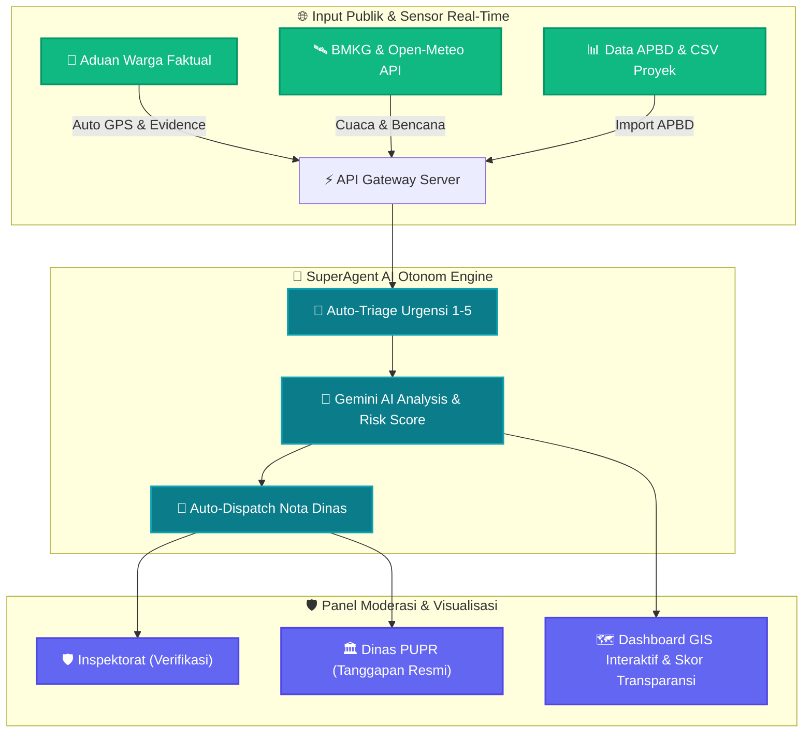

<div align="center">
  

  <br />

  <a href="https://github.com/s1informatika11s25007-maker/terang_akuntabilitas_publik">
    
  </a>

  <br />

  [](https://opensource.org/licenses/Apache-2.0)
  [](https://react.dev/)
  [](https://www.typescriptlang.org/)
  [](https://tailwindcss.com/)
  [](https://vitejs.dev/)
  [](https://ai.google.dev/)
</div>

---

> **💡 TERANG (Transparansi & Evaluasi Realisasi Anggaran Negara)** adalah platform digital pengawasan akuntabilitas publik dan transparansi APBD Sumatera Utara berbasis AI otonom, pemetaan GIS interaktif, dan moderasi aduan warga secara real-time. Platform ini memungkinkan publik dan instansi pemerintah memantau deviasi fisik vs keuangan proyek APBD di 33 Kabupaten/Kota secara presisi dan akuntabel.

---

## 🏗️ Diagram Alur Kerja & Arsitektur Sistem 3D



---

## 🚀 Progress & Fitur Aplikasi Saat Ini

Aplikasi TERANG telah dilengkapi dengan fitur-fitur utama yang siap digunakan secara penuh (*fully functional*):

| Modul / Halaman | Status Progress | Deskripsi & Kapabilitas Utama |
| :--- | :---: | :--- |
| **🏠 Beranda (Landing View)** | `100% Selesai` | Banner visual interaktif, KPI statistik APBD real-time, ringkasan proyek deviasi tinggi, dan peta skor transparansi daerah. |
| **🗺️ Dashboard Transparansi & GIS** | `100% Selesai` | Peta Leaflet interaktif 33 Kab/Kota Sumut, skor transparansi wilayah, visualisasi serapan anggaran, dan filter sektoral. |
| **🏗️ Katalog Proyek Publik** | `100% Selesai` | Katalog proyek infrastruktur, grafik deviasi fisik vs realisasi anggaran, pencarian proyek, dan pengaduan proyek spesifik. |
| **📝 Formulir Laporan Aduan Faktual** | `100% Selesai` | Pengaduan warga faktual dengan auto-tagging koordinat GPS, lampiran bukti foto, serta opsi mode anonim / bernama. |
| **🔍 Pelacakan Aduan Real-Time** | `100% Selesai` | Pencarian status aduan real-time menggunakan Kode Pelacakan unik (`TRG-2026-XXXXXX`) dengan timeline transparan. |
| **📋 Daftar Laporan Publik** | `100% Selesai` | Etalase transparansi laporan warga yang lolos verifikasi beserta catatan tindak lanjut Inspektorat dan Dinas terkait. |
| **📊 Insight & Analisis AI** | `100% Selesai` | Analisis prediktif deviasi anggaran, identifikasi potensi kemacetan proyek, serta rekomendasi optimasi alokasi APBD. |
| **📖 Data & Metodologi** | `100% Selesai` | Dokumentasi terbuka rumus kalkulasi Serapan Anggaran, Gap Indicator, dan Skor Akuntabilitas Publik. |
| **🛡️ Panel Pengelola & Moderasi** | `100% Selesai` | Panel kontrol *Role-Based Access Control (RBAC)* untuk **Super Admin**, **Verifikator Inspektorat**, dan **Instansi Dinas PUPR**. |
| **⚡ Agen Pengawasan Otonom** | `100% Selesai` | Mesin pengawasan otonom *SuperAgent AI* 1-klik untuk pemindaian 33 Kab/Kota, auto-triage urgensi aduan, dan auto-dispatch nota dinas. |
| **💬 Pusat Informasi Tanya TERANG** | `100% Selesai` | Chatbot asisten AI interaktif untuk konsultasi anggaran APBD dan informasi status aduan warga. |

---

## 💻 Tech Stack & Teknologi

* **Frontend Framework**: [React 18](https://react.dev/) dengan [TypeScript 5.5](https://www.typescriptlang.org/)
* **Build Tool & Bundler**: [Vite 5.4](https://vitejs.dev/) & [Bun](https://bun.sh/)
* **Styling & UI**: [Tailwind CSS 3.4](https://tailwindcss.com/), Lucide React Icons, & Animation Keyframes
* **Interactive Mapping (GIS)**: [Leaflet GIS](https://leafletjs.com/) & GeoJSON Sumatera Utara (33 Kabupaten/Kota)
* **Backend Server**: [Express.js](https://expressjs.com/) & Node.js ESM Runtime
* **Artificial Intelligence**: Google Gemini AI (`@google/genai`) & SuperAgent Auto-Pilot Rule Engine
* **Open Data Integration**: BMKG Open Data (Gempabumi & Cuaca), Open-Meteo API, & USGS FDSN Service

---

## 🛠️ Cara Menjalankan Project (Panduan Lokal)

### Persyaratan Sistem
* **Node.js**: v20.19+ atau v22.12+
* **Package Manager**: `npm` atau `bun`

### Langkah-Langkah Instalasi:

```bash
# 1. Clone repositori ke komputer lokal Anda
git clone https://github.com/s1informatika11s25007-maker/terang_akuntabilitas_publik.git

# 2. Masuk ke direktori proyek
cd terang_akuntabilitas_publik

# 3. Install seluruh dependensi proyek
npm install

# 4. Salin file environment contoh ke .env.local
cp .env.example .env.local

# 5. Jalankan server pengembangan (Development Mode)
npm run dev
```

Buka peramban Anda di alamat:  
👉 **`http://localhost:5173`** (atau port yang diberikan oleh Vite)

---

## 🔑 Akun Demo & Hak Akses Pengelola

Gunakan akun demo berikut untuk menguji fitur moderasi berbasis peran (*Role-Based Access Control*):

| Role / Peran | Email Sesi Demo | Kata Sandi Demo | Hak Akses & Fitur Khusus |
| :--- | :--- | :--- | :--- |
| **Super Admin** | `admin@terang.test` | *(Sesuai `DEMO_PASSWORD` di `.env`)* | Full Akses: Moderasi Aduan, Tanggapan Instansi, Impor CSV Data APBD & Proyek, serta Audit Trail Logs. |
| **Verifikator Inspektorat** | `verifikator@terang.test` | *(Sesuai `DEMO_PASSWORD` di `.env`)* | Khusus Verifikasi Faktual Aduan Warga, penentuan tingkat urgensi, dan penolakan ber-alasan rasional. |
| **Instansi Dinas PUPR** | `instansi@terang.test` | *(Sesuai `DEMO_PASSWORD` di `.env`)* | Khusus Penerbitan Tanggapan Resmi Instansi dan pembaruan status tindak lanjut proyek di timeline publik. |

> [!NOTE]
> Kata sandi default untuk semua akun demo didefinisikan pada variabel `DEMO_PASSWORD` dalam berkas `.env` (default: `password`).

---

## 📁 Struktur Folder Proyek (100% Presisi)

<details>
<summary>📂 <strong>Klik di sini untuk melihat struktur pohon folder lengkap</strong></summary>

```text
terang_akuntabilitas_publik/
├── .env.example                # Templat konfigurasi variabel lingkungan
├── .gitignore                  # Konfigurasi pengabaian Git
├── CHANGELOG.md                # Catatan riwayat pembaruan versi
├── README.md                   # Dokumentasi utama proyek
├── bun.lock                    # Lockfile dependensi Bun
├── index.html                  # Dokumen HTML utama Vite
├── metadata.json               # Metadata proyek
├── package-lock.json           # Lockfile dependensi npm
├── package.json                # Dependensi dan skrip proyek
├── server.ts                   # Entry point server Express.js & API backend
├── tsconfig.json               # Konfigurasi TypeScript
├── vite.config.ts              # Konfigurasi build Vite
├── database/
│   └── data/
│       ├── README-data.md      # Dokumentasi dataset terbuka
│       ├── apbd_realisasi.csv  # Dataset APBD & Realisasi 33 Kab/Kota
│       ├── kabkota_sumut.geojson # Data spasial batas wilayah Sumut
│       └── proyek_publik.csv   # Dataset katalog proyek infrastruktur
├── docs/
│   ├── erd.md                  # Dokumentasi Diagram Relasi Entitas
│   ├── features.md             # Rincian fitur aplikasi
│   └── sitemap.md              # Peta situs dan struktur navigasi
├── public/
│   └── terang_hero_banner_1792932754839.jpg # Banner publik
├── scripts/
│   ├── generate_csv.ts         # Skrip pembangkit dataset sintetik
│   └── import.ts               # Skrip pengimpor data CSV
└── src/
    ├── App.tsx                 # Komponen utama & Route Guard terpusat
    ├── global.d.ts             # Deklarasi tipe global
    ├── index.css               # Styling global Tailwind CSS & animasi
    ├── main.tsx                # Entry point React DOM
    ├── assets/
    │   └── images/
    │       └── terang_hero_banner_1792932754839.jpg
    ├── components/
    │   ├── AuthModal.tsx       # Modal login akun pengelola (demo role)
    │   ├── Footer.tsx          # Komponen footer navigasi & hak cipta
    │   ├── LeafletMap.tsx      # Komponen Peta GIS interaktif Leaflet
    │   ├── Navbar.tsx          # Navigasi utama dinamis berbasis role
    │   ├── PageHero.tsx        # Header visual halaman
    │   ├── PageMotion.tsx      # Pembungkus animasi transisi halaman
    │   └── TanyaTerangModal.tsx # Modal Asisten AI Tanya TERANG
    ├── data/
    │   ├── budgetsData.ts      # Data anggaran & realisasi
    │   ├── geoJsonSumut.ts     # Peta spasial GeoJSON Sumut
    │   ├── projectsData.ts     # Data proyek infrastruktur publik
    │   ├── regionsData.ts      # Master data 33 Kabupaten/Kota
    │   ├── reportsData.ts      # Data laporan & aduan warga
    │   └── sectorsData.ts      # Master data sektor APBD
    ├── lib/
    │   ├── calculations.ts     # Fungsi kalkulasi skor transparansi & deviasi
    │   └── calculations.test.ts # Unit testing kalkulasi matematika
    ├── server/
    │   ├── aiService.ts        # Layanan integrasi Google Gemini AI
    │   ├── db.ts               # In-memory database store & audit logs
    │   ├── liveData.ts         # Integrasi BMKG, Open-Meteo, & USGS
    │   ├── loadEnv.ts          # Pengisi variabel lingkungan server
    │   └── superAgent.ts       # Mesin otonom SuperAgent AI
    └── views/
        ├── AboutView.tsx        # Halaman tentang platform TERANG
        ├── AdminView.tsx        # Panel kendali & moderasi terpadu
        ├── AgentAutomationView.tsx # Tampilan eksekusi SuperAgent AI
        ├── DashboardView.tsx    # Dashboard GIS & Skor Akuntabilitas
        ├── DataMethodologyView.tsx # Metodologi kalkulasi data
        ├── InsightView.tsx      # Analisis risiko & prediksi AI
        ├── LandingView.tsx      # Beranda utama platform
        ├── ProjectsView.tsx     # Katalog proyek & deviasi fisik/keuangan
        ├── PublicReportsView.tsx # Etalase laporan warga terverifikasi
        ├── ReportFormView.tsx   # Formulir pengaduan warga faktual
        └── TrackReportView.tsx  # Pelacakan status aduan real-time
```
</details>

---

## ⚡ Fitur Utama SuperAgent AI (Agen Otonom 1-Klik)

Proyek ini dilengkapi **SuperAgent AI**, sebuah agen pengawasan otonom yang dapat mengeksekusi alur kerja pengawasan secara otomatis tanpa delay manual:

1. **Pemindaian Otonom 33 Kab/Kota**: Memindai seluruh paket proyek aktif dan mendeteksi deviasi fisik $\ge 25\%$.
2. **Auto-Triase Urgensi Aduan**: Menganalisis teks laporan warga dan menetapkan skala urgensi (Skala 1-5).
3. **Auto-Dispatch Nota Dinas**: Menerbitkan draf rekomendasi tindak lanjut secara otomatis ke Inspektorat dan Dinas terkait.
4. **Monitoring Faktor Bencana Alam**: Mengintegrasikan API langsung BMKG (Gempabumi M4+) dan Open-Meteo (Curah hujan ekstrim $>150\text{ mm}/14\text{ hari}$) untuk mengevaluasi klaim *force majeure*.

---

<div align="center">
  

  <p>Diterbitkan di bawah lisensi <strong>Apache License 2.0</strong>. Hak Cipta © 2026 Tim TERANG Akuntabilitas Publik Sumatera Utara.</p>
</div>
